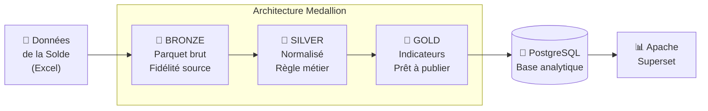
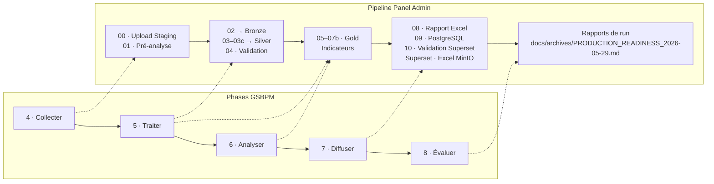
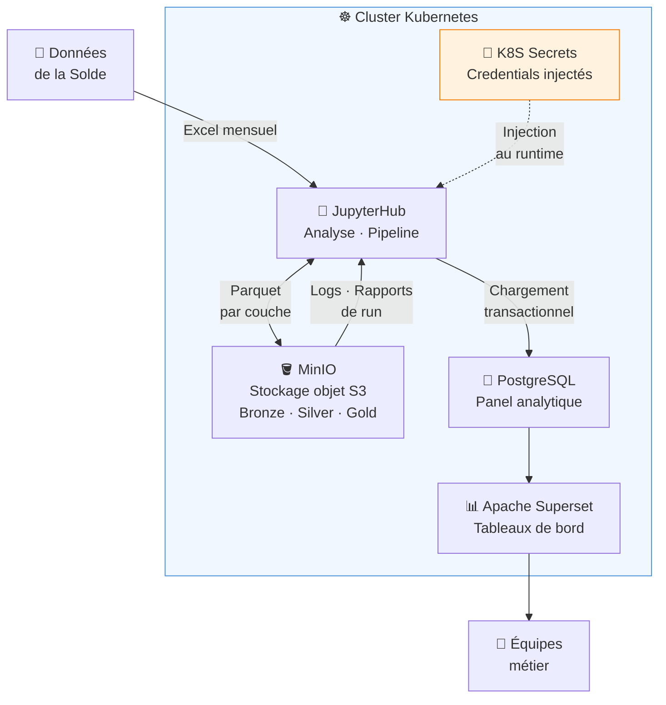

# Moderniser la production statistique en Afrique de l'Ouest : comment le Data Engineering entre dans la statistique publique

**Cellule d'Analyses Économiques — ANSTAT**\
*Mai 2026*

> **Résumé.** Nous sommes partis d'une source administrative très riche, mais difficile à stabiliser dans le temps. Pour produire des indicateurs fiables sur les salaires publics, l'ANSTAT a mis en place une chaîne de production plus robuste : architecture Medallion, orchestration Python, stockage objet, PostgreSQL, Superset, Git et documentation d'exploitation. L'enjeu n'est pas seulement de gagner du temps. Il est de pouvoir expliquer, reprendre et vérifier chaque chiffre publié.

---

## Avant-propos : une question de crédibilité

La statistique publique repose sur un contrat de confiance. Les ménages répondent aux enquêtes, les administrations transmettent leurs données, les décideurs orientent leurs politiques. Tout cela suppose que les chiffres publiés sont justes, comparables dans le temps, et produits selon une méthode que l'on peut expliquer. Cette confiance prend du temps à construire. Elle peut se perdre très vite.

Elle suppose non seulement que les méthodes statistiques sont rigoureuses, mais que la **chaîne de production** qui les met en œuvre l'est tout autant. Or dans beaucoup d'agences statistiques nationales, cette chaîne repose encore sur des architectures fragiles : des scripts dont la logique est implicite, des traitements manuels reproduits à chaque publication sans trace formelle, des résultats dont la reproductibilité dépend d'une seule personne encore en poste.

Ce billet raconte comment nous avons commencé à changer cela, à l'ANSTAT, sur un cas concret : la production des indicateurs de salaires dans l'administration publique en Côte d'Ivoire. Le sujet peut sembler technique. Il est surtout très concret. Derrière chaque script, chaque table et chaque rapport, il y a une question simple : si la personne qui a construit le pipeline n'est pas là demain, l'équipe pourra-t-elle quand même produire, comprendre et défendre les chiffres ?

---

## Le point de départ : une source riche, un schéma instable

Les données de la solde constituent une **source administrative unique**, produite dans un cadre réglementaire commun. Disponibles depuis 2015 et actualisées au fil des nouvelles périodes, elles forment un panel d'une richesse considérable pour analyser les niveaux de rémunération, les écarts salariaux entre hommes et femmes, la conformité au barème de la fonction publique, l'évolution des effectifs par grade et par corps.

Mais une source unique n'est pas une source stable.

Sur une série qui s'allonge année après année, les schémas évoluent. Des colonnes sont renommées lors des réformes de la fonction publique. D'autres apparaissent ou disparaissent avec les changements de système de paie. Les libellés de grades sont harmonisés, puis modifiés à nouveau. Ce qui était `CLASSE_ECHELON` devient `GRADE`, puis `STATUT_FONCTIONNAIRE`. Ce qui était une colonne en devient deux. Ce qui était un code numérique devient un libellé textuel.

**L'hétérogénéité n'est pas spatiale — elle est temporelle.**

C'est précisément ce type de dérive que les architectures traditionnelles gèrent mal. Quand une colonne est renommée, il faut aller corriger chaque script qui la référence. Quand un grade est ajouté, il faut retrouver où la liste était codée en dur. Quand un mois manque, il faut décider d'une règle d'imputation, l'appliquer, et espérer que la décision est documentée quelque part.

Nous avons voulu rendre ce processus explicite, traçable, et reproductible. Cela suppose de traiter la chaîne statistique comme un vrai outil de production : des fichiers d'entrée bien identifiés, des règles écrites noir sur blanc, des contrôles qualité, des sorties vérifiées, des logs et une documentation que l'on maintient au fil du projet. Autrement dit, il ne s'agit pas seulement de "faire tourner un code". Il faut aussi pouvoir expliquer ce que le code a fait.

---

## L'architecture Medallion : un principe venu du monde tech, parfaitement adapté à la statistique officielle

Le Data Engineering a développé un pattern d'organisation des données connu sous le nom d'**architecture Medallion** [1,2]. L'idée est de faire transiter les données par des couches successives, chacune avec un rôle précis et un niveau de qualité garanti. Chaque couche est immuable : les données brutes ne sont jamais modifiées, chaque transformation est explicite et reproductible.

Cette séparation rend le travail plus lisible. La couche Bronze garde une copie fidèle de la source, même lorsque cette source est imparfaite. La couche Silver concentre le travail de nettoyage et de normalisation : harmoniser les colonnes, stabiliser les types, appliquer les règles métier et documenter les imputations. La couche Gold ne contient plus une matière première, mais des indicateurs prêts à être contrôlés, analysés et diffusés. Ce découpage évite de tout mélanger dans un même script : l'ingestion, la correction, l'interprétation et la publication.



Ce principe s'applique remarquablement bien à la statistique officielle — pour une raison simple : la statistique publique a des exigences de traçabilité et d'auditabilité qui sont précisément ce que l'architecture Medallion garantit.

- Si une erreur est découverte dans la normalisation Silver, on corrige la règle et on rejoue depuis Silver. Les données brutes originales restent intactes.
- On peut reconstituer n'importe quel état intermédiaire du traitement.
- On peut répondre à la question *"d'où vient ce chiffre ?"* avec une réponse complète et vérifiable.

Ce point est essentiel pour la statistique publique. Un chiffre publié n'est jamais seulement une valeur numérique. C'est le résultat d'une suite de choix : quelles lignes retenir, quels grades considérer comme valides, comment traiter les salaires manquants, quel seuil appliquer aux valeurs extrêmes. Quand l'architecture est explicite, ces choix ne restent pas dans des fichiers personnels ou dans la mémoire des analystes. Ils deviennent visibles, versionnés et discutables.

---

## Le pipeline en dix étapes

Notre implémentation déroule l'architecture Medallion en dix étapes numérotées, chacune avec une responsabilité clairement définie et une trace de son exécution. Cette numérotation n'est pas seulement une façon de ranger les scripts. Elle permet à l'équipe de parler du pipeline sans ambiguïté. Si un contrôle échoue à l'étape 04, on sait que le problème se situe dans la validation Silver. Si une anomalie apparaît dans Superset, on peut remonter vers l'étape 10, puis vers les vues SQL, puis vers les tables Gold qui les alimentent.

```mermaid
flowchart TD
    S0["00 · Upload Staging\nExcel → MinIO"]
    S1["01 · Pré-analyse\nDétection des variations\nde schéma"]
    S2["02 · Staging → Bronze\nExcel → Parquet columnar"]
    S3["03 · Bronze → Silver\nMapping colonnes\nNormalisation"]
    S3b["03b · Imputation Grades\nCascade emploi P1/P2/P3"]
    S3c["03c · Imputation Salaires\nLOCF + Médiane"]
    S4["04 · Validation Silver\nContrôles qualité"]
    S5["05 · Silver → Gold\nAgrégations mensuelles"]
    S6["06 · Compilation Panel\nHistorique individuel"]
    S7["07 · Statuts Barème\nConformité M1 + M2"]
    S7a["07a · Imputation Hors-Barème\nForward/backward fill"]
    S7b["07b · Calcul Indicateurs\nExcel technique"]
    S8["08 · Rapport Excel\nSommaire navigable"]
    S9["09 · Chargement PostgreSQL\nSwap transactionnel"]
    S10["10 · Validation Superset\nVues SQL testées"]

    S0 --> S1 --> S2 --> S3 --> S3b --> S3c --> S4
    S4 --> S5 --> S6 --> S7 --> S7a --> S7b --> S8 --> S9 --> S10

    style S0 fill:#e8f4f8
    style S1 fill:#e8f4f8
    style S2 fill:#cd7f32,color:#fff
    style S3 fill:#cd7f32,color:#fff
    style S3b fill:#cd7f32,color:#fff
    style S3c fill:#cd7f32,color:#fff
    style S4 fill:#c0c0c0
    style S5 fill:#c0c0c0
    style S6 fill:#ffd700
    style S7 fill:#ffd700
    style S7a fill:#ffd700
    style S7b fill:#ffd700
    style S8 fill:#ffd700
    style S9 fill:#2e7d32,color:#fff
    style S10 fill:#2e7d32,color:#fff
```



**Staging (bleu)** — réception et analyse structurelle des sources.\
**Bronze (marron)** — ingestion fidèle, conversion en Parquet, zéro transformation métier.\
**Silver/Gold (gris → jaune)** — normalisation progressive, enrichissement, calcul des indicateurs.\
**PostgreSQL/Superset (vert)** — publication et visualisation.

Chaque étape produit donc une sortie compréhensible, que l'étape suivante peut reprendre. Cette discipline évite beaucoup de mauvaises surprises : une règle changée dans la normalisation ne doit pas être recopiée à la main dans les scripts de diffusion ; un changement de format dans la source ne doit pas casser les tableaux de bord ; une correction méthodologique doit pouvoir être rejouée sans bricoler tout le processus.

---

## Alignement avec le GSBPM

Le **GSBPM** (Generic Statistical Business Process Model), développé sous l'égide de l'UNECE, est le cadre de référence international pour décrire et améliorer les processus de production statistique [3]. Notre pipeline s'y aligne naturellement, ce qui facilite son audit par des pairs et son intégration dans un système qualité institutionnel.



| Phase GSBPM | Sous-processus GSBPM | Étapes pipeline |
|---|---|---|
| **4 · Collecter** | 4.3 Exécution de la collecte | 00 · Upload Staging |
| **4 · Collecter** | 4.4 Finalisation de la collecte | 01 · Pré-analyse, détection des variations de schéma |
| **5 · Traiter** | 5.1 Intégration des données | 02 · Staging → Bronze (Excel → Parquet) |
| **5 · Traiter** | 5.2 Classification et codage | 03 · Bronze → Silver (mapping colonnes, normalisation) |
| **5 · Traiter** | 5.3 Révision et validation | 04 · Validation Silver (contrôles qualité) |
| **5 · Traiter** | 5.4 Édition et imputation | 03b · Imputation grades, 03c · Imputation salaires, 07a · Hors-barème |
| **5 · Traiter** | 5.5 Dérivation de nouvelles variables | 05 · Silver → Gold, 06 · Panel, 07 · Statuts barème |
| **5 · Traiter** | 5.7 Calcul des agrégats | 07b · Calcul indicateurs (moyennes, médianes, percentiles) |
| **6 · Analyser** | 6.1 Préparation des sorties | 08 · Rapport Excel sommaire |
| **6 · Analyser** | 6.2 Validation des sorties | 10 · Validation SQL Superset |
| **7 · Diffuser** | 7.1 Mise à jour des systèmes de diffusion | 09 · Chargement PostgreSQL (swap transactionnel) |
| **7 · Diffuser** | 7.2 Production des produits de diffusion | Superset (tableaux de bord) · Excel téléchargeable depuis MinIO |
| **8 · Évaluer** | 8.2 Mesure de la qualité du processus | Rapports de run horodatés, `docs/archives/PRODUCTION_READINESS_2026-05-29.md` |

Cette correspondance n'est pas cosmétique. Elle signifie que chaque étape du pipeline a une responsabilité unique et délimitée, alignée sur une phase du cycle statistique. La séparation Bronze / Silver / Gold reflète directement la distinction GSBPM entre intégration brute (5.1), traitement et validation (5.2–5.5), et production des agrégats (5.7). Les métadonnées de run — paramètres méthodologiques versionnés, logs archivés, rapports horodatés — répondent aux exigences de la phase 8 (Évaluer) sans travail supplémentaire.

L'intérêt est aussi très pratique. Le GSBPM donne un langage commun aux statisticiens, aux informaticiens, aux responsables qualité et aux partenaires administratifs. Le pipeline n'est plus une suite opaque de scripts Python. Il devient la mise en œuvre concrète d'un processus statistique reconnu. Cela aide dans les revues méthodologiques, les audits internes et la formation des nouveaux arrivants.

---

## Git : la colonne vertébrale du processus

Derrière chaque outil décrit dans ce billet, il y a un élément plus discret mais central : **Git** [4,5]. On l'associe souvent au développement logiciel. Ici, il joue aussi un rôle de registre d'audit de la production statistique.

### Chaque décision méthodologique est un commit

Quand les agences administratives partenaires notifient un changement — une réforme de la grille indiciaire, un grade supprimé, une nouvelle catégorie — la mise à jour se traduit par une modification du fichier `pipeline_settings.yaml` et un commit Git avec un message explicatif :

```bash
git commit -m "refactor(grades): restreindre aux grades barème doc. méthodologique 28/05/2026

Suppression de A1, A2, B2, B4-B6, C4-C5, D3 conformément
à la note de la DG du 27 mai 2026."
```

Dans six mois, `git log` permet de retrouver exactement quand cette décision a été prise, par qui, et pourquoi. C'est la traçabilité des décisions méthodologiques que tout système qualité statistique exige.

### Le code et la configuration évoluent ensemble

Le code Python du pipeline, la configuration YAML, la documentation LaTeX et les scripts SQL des vues Superset sont tous dans le même dépôt Git. Un changement méthodologique qui touche le code et la configuration est atomique : on ne peut pas versionner l'un sans l'autre. C'est ce qui évite les désynchronisations entre ce que le code fait, ce que la configuration active et ce que la documentation décrit.

### Les rapports de run comme archive d'audit

Chaque exécution du pipeline génère un rapport Markdown horodaté. Ces rapports sont archivés dans MinIO et peuvent, selon la politique de conservation retenue, être versionnés dans Git :

```bash
git add reports/
git commit -m "run 2026-05-29 — pipeline complet, 10 étapes OK, 847 243 lignes chargées"
```

L'historique du dépôt devient alors un registre exploitable des exécutions de production : dates, paramètres, résultats, anomalies et corrections. Les bonnes pratiques de recherche reproductible le rappellent clairement : le versionnement n'est pas réservé aux développeurs. C'est aussi une condition de l'intégrité scientifique [6,7].

## L'infrastructure : une stack cloud-native sur Kubernetes

Toute la chaîne est déployée sur un **cluster Kubernetes** opéré en interne. JupyterHub, MinIO, PostgreSQL et Apache Superset cohabitent sur la même infrastructure, gérée par K8S.



Cette colocalisation sur K8S n'est pas un détail d'infrastructure. Elle a trois conséquences directes sur la qualité du pipeline :

**1. Les secrets ne touchent jamais le code.** Les credentials MinIO, PostgreSQL et les clés d'accès sont injectés via des Kubernetes Secrets au moment de l'exécution. Aucune valeur sensible n'apparaît dans le code source ou les fichiers de configuration versionnés.

**2. La résilience est gérée par l'infrastructure, pas par le code.** La disponibilité de MinIO et de PostgreSQL est garantie par K8S — redémarrages automatiques, health checks, isolation des pods. Le pipeline n'a pas à gérer ces scénarios.

**3. Les logs et rapports sont persistants.** Chaque run de l'orchestrateur archive automatiquement son fichier de log et son rapport Markdown dans MinIO. Sur JupyterHub, les sessions expirent et les terminaux se ferment : cette persistance garantit qu'aucune trace d'exécution n'est perdue.

---

## Les choix techniques : chaque décision a une raison

### Polars plutôt que Pandas

Les données de la solde couvrent des périodes mensuelles depuis 2015 pour l'ensemble de l'administration publique, avec une série qui continue à s'enrichir. Polars [8], bibliothèque Python écrite en Rust, est deux à dix fois plus rapide que Pandas sur ces volumes, exploite nativement le parallélisme, et impose des types stricts qui attrapent les erreurs de données tôt plutôt que de les propager silencieusement. Ce n'est pas un choix de mode — c'est un choix de robustesse.

Dans une chaîne statistique, la performance n'est pas seulement une question de confort. Elle permet de rejouer les traitements, de tester plusieurs hypothèses méthodologiques et de corriger rapidement une anomalie détectée tardivement. Quand un pipeline est trop lent, les contrôles deviennent exceptionnels. Quand il est rapide, ils deviennent une habitude de travail.

### Le mapping par expressions régulières

La normalisation des colonnes ne repose pas sur une liste figée de correspondances, mais sur des **expressions régulières configurées dans un fichier YAML** :

```yaml
montant_brut:
  - "MONTANT_BRUT"
  - "SALAIRE_BRUT"
  - "REMUNERATION_BRUTE"
  - "^BRUT$"
```

Quand un libellé change dans la source, on ajoute un pattern. Le code ne change pas. Cette séparation entre la logique de traitement et la connaissance métier est ce qui rend le pipeline adaptable à la dérive temporelle des schémas.

Cette décision paraît modeste, mais elle rend la maintenance beaucoup plus saine. Le statisticien peut relire les règles de correspondance dans un fichier de configuration. L'ingénieur peut vérifier que le moteur les applique correctement. L'auditeur peut voir qu'un changement de nomenclature a été traité comme une décision explicite, et non comme une correction discrète dans un script.

### L'imputation en cascade

Les grades et salaires manquants sont imputés selon une logique de **cascade de précision décroissante** :


Cette hiérarchie est explicite, documentée, et paramétrable. Elle peut être modifiée sans toucher au code de traitement. Surtout, elle garde la mémoire de ce qui a été imputé et de ce qui ne l'a pas été. Une valeur imputée n'est jamais confondue avec une valeur observée : elle porte son statut, sa méthode et son niveau de précision. C'est une condition indispensable pour publier des indicateurs honnêtes.

### Apache Superset pour la visualisation

En bout de chaîne, **Apache Superset** [9] — déployé sur le même cluster K8S — expose les indicateurs sous forme de tableaux de bord interactifs accessibles aux équipes métier. Les vues SQL qui alimentent ces dashboards font partie du pipeline : elles sont versionnées, et leur validité est testée automatiquement à chaque run par l'étape 10.

Le pipeline produit également des **fichiers Excel téléchargeables** — un rapport sommaire navigable et un fichier d'indicateurs techniques — déposés automatiquement dans MinIO à chaque run. Les analystes peuvent les récupérer directement depuis le stockage objet, sans passer par Superset, pour des travaux ad hoc ou des transmissions externes.

---

## L'orchestrateur : la pièce qui rend tout opérable

Un pipeline qui recommence de zéro à chaque erreur n'est pas opérable en production. Sur dix étapes qui prennent plusieurs heures, une erreur à l'étape 7 ne devrait pas signifier rejouer les six premières.

Notre orchestrateur Python maintient un **fichier d'état** après chaque étape réussie. En cas d'échec, l'analyste corrige le problème et lance :

```bash
python orchestrateur.py --resume
```

Le pipeline repart exactement là où il s'est arrêté. C'est indispensable dans la vraie vie : les erreurs ne surviennent pas toujours au début, et les analystes doivent pouvoir corriger une source, un paramètre ou une vue SQL sans perdre plusieurs heures de calcul déjà validées. D'autres modes sont disponibles :

| Commande | Comportement |
|---|---|
| `python orchestrateur.py` | Pipeline complet |
| `python orchestrateur.py --depuis 06` | Reprend à l'étape 06 |
| `python orchestrateur.py --etapes 07 08` | Étapes ciblées uniquement |
| `python orchestrateur.py --dry-run` | Affiche le plan sans exécuter |
| `python orchestrateur.py --resume` | Reprend après un échec |
| `python orchestrateur.py --force` | Efface l'état et tout rejoue |

À chaque run, un **rapport Markdown horodaté** est généré automatiquement et archivé sur MinIO :

```
panel_admin/logs/2026-05/run_20260529_143022.md
panel_admin/logs/2026-05/run_20260529_143022.log
```

Dans six mois, on peut ouvrir ce rapport et voir exactement ce qui s'est passé, étape par étape, avec les durées et les éventuels échecs. C'est une trace d'audit que la statistique officielle est supposée avoir et que, trop souvent, elle n'a pas. Cette trace transforme aussi le dialogue entre métiers et technique : on ne discute plus sur la base d'impressions, mais sur la base d'un historique d'exécution.

---

## La configuration méthodologique hors du code

Dans un pipeline statistique, certains paramètres relèvent de l'ingénieur. D'autres relèvent du **statisticien et des agences administratives partenaires** : quels grades inclure, quelle période couvrir, quel seuil d'écrêtage des valeurs extrêmes appliquer.

Nous avons séparé ces deux niveaux. Tous les paramètres méthodologiques vivent dans un fichier `pipeline_settings.yaml` versionné avec le code, mais modifiable sans écrire une ligne de Python :

```yaml
methodology:
  mode_salaire_brut: true       # agrégation par poste
  periode_recente: true         # fenêtre récente paramétrable
  inclure_zeros: true           # inclure salaires nuls
  seuil_wins: 0.01              # écrêtage à P1/P99
  min_obs_wins: 100             # seuil de repli
  grades_valides:               # liste du doc. méthodologique 28/05/2026
    - "A3"
    - "A4"
    - "A5"
    - "A6"
    - "A7"
    - "B1"
    - "B3"
    - "C1"
    - "C2"
    - "C3"
    - "D1"
    - "D2"
```

Quand les agences administratives partenaires notifient un changement — une réforme de la grille indiciaire, un grade supprimé, une nouvelle catégorie — la modification se traduit par une mise à jour du fichier YAML et un commit Git avec un message explicatif. Dans l'historique du dépôt, on voit exactement quand la décision a été prise et en réponse à quoi. Les paramètres du run sont également sauvegardés dans MinIO à chaque exécution — traçabilité complète des choix méthodologiques.

Cette séparation protège aussi la gouvernance du projet. Les paramètres qui relèvent de la méthode peuvent être discutés, validés et modifiés sans ouvrir le code applicatif. Le code reste le moteur stable ; la configuration porte les choix statistiques.

---

## Ce que ça change pour les équipes

L'impact le plus profond de cette transformation n'est pas technique. Il est humain.

Quand le pipeline est opaque, une seule personne le maîtrise vraiment. Son départ emporte une fraction critique de la connaissance institutionnelle. La publication suivante est compromise. L'équipe passe des semaines à reconstituer ce qui aurait dû être documenté.

Quand le pipeline est explicite, documenté, et accompagné d'un **manuel d'exploitation rédigé pour quelqu'un qui n'en est pas l'auteur**, la transmission devient possible. Un nouveau statisticien peut lire la note méthodologique, comprendre chaque étape, et produire un run supervisé en quelques jours.

La documentation officielle du projet — note méthodologique, architecture technique, manuel d'exploitation — est rédigée en LaTeX et **versionnée avec le code source**. Elle n'est pas une formalité administrative produite après coup. Elle est mise à jour à chaque modification substantielle du pipeline. Elle est la condition de la continuité institutionnelle.

La différence se voit dans les gestes quotidiens. Un analyste peut relancer un traitement sans demander quel fichier utiliser. Un responsable peut demander pourquoi un indicateur a changé entre deux publications et obtenir une réponse documentée. Un nouvel arrivant peut apprendre le système en lisant le manuel, les logs et l'historique Git, au lieu de dépendre uniquement d'explications orales.

---

## Les limites honnêtes

Ce pipeline n'est pas parfait. Nous le savons et nous le documentons.

**Les tests ne couvrent pas encore le chemin complet.** La suite pytest couvre les fonctions pures — normalisation, imputation, pseudonymisation. Elle ne teste pas encore le chemin Source → Bronze → Silver → Gold sur un échantillon anonymisé. Ce chantier est ouvert.

**Les seuils de qualité bloquants ne sont pas encore tous formalisés.** Le pipeline signale les anomalies — taux de matching faible, périodes manquantes, nulls inhabituels — mais certains seuils ne sont pas encore automatiquement bloquants. Définir précisément ce qui arrête le pipeline versus ce qui émet un avertissement est une décision méthodologique en cours.

Ces limites sont documentées dans un fichier `docs/archives/PRODUCTION_READINESS_2026-05-29.md` versionné avec le code. Une équipe qui sait nommer ses risques résiduels est une équipe qui les corrige.

---

## Conclusion : l'infrastructure invisible de la statistique

Il existe une forme d'infrastructure invisible — comme les routes ou les réseaux d'eau — dont on ne mesure la valeur qu'au moment où elle fait défaut. La chaîne de production statistique en fait partie.

Ce que nous avons construit n'est pas exceptionnel sur le plan technique. L'architecture Medallion est un pattern documenté. Polars, MinIO, PostgreSQL, Kubernetes et Apache Superset sont des outils open source matures. Ce qui est peut-être moins commun, c'est d'avoir décidé que cette chaîne méritait autant d'attention que le produit final. Que le pipeline est une **infrastructure statistique à part entière**, pas un détail d'implémentation.

Cette conviction — et les pratiques qu'elle engendre — est directement transposable à d'autres domaines de la statistique administrative : les registres d'état civil, les bases fiscales, les données d'enquêtes avec collecte numérique. Partout où une source doit alimenter une publication régulière, les principes décrits ici s'appliquent.

La question n'est pas de savoir si nos agences peuvent se l'offrir. Les outils sont gratuits, les compétences s'acquièrent. Le vrai coût est ailleurs : erreurs non détectées, heures perdues à chaque publication, dépendance à quelques personnes clés. Ce coût-là est souvent sous-estimé.

---

*Ce pipeline est développé à la Cellule d'Analyses Économiques de l'ANSTAT. Les données de la solde utilisées sont soumises au secret statistique et ne sont pas diffusées. La documentation officielle est versionnée avec le code source du pipeline.*

---

## Références

1. **Databricks.** (2024). *What is the Medallion Lakehouse Architecture?* Databricks Documentation. <https://www.databricks.com/glossary/medallion-architecture>
2. **Armbrust, M., Das, T., Torres, J. et al.** (2021). *Lakehouse: A New Generation of Open Platforms that Unify Data Warehousing and Advanced Analytics.* CIDR 2021.
3. **UNECE Statistics Division.** (2019). *Generic Statistical Business Process Model (GSBPM), Version 5.1.* United Nations Economic Commission for Europe. <https://unece.org/statistics/modernstats/gsbpm>
4. **Blischak, J. D., Davenport, E. R., & Wilson, G.** (2016). *A Quick Introduction to Version Control with Git and GitHub.* PLOS Computational Biology, 12(1). <https://doi.org/10.1371/journal.pcbi.1004668>
5. **Perez-Riverol, Y. et al.** (2016). *Ten Simple Rules for Taking Advantage of Git and GitHub.* PLOS Computational Biology, 12(7). <https://doi.org/10.1371/journal.pcbi.1004947>
6. **Wilson, G., Bryan, J., Cranston, K. et al.** (2017). *Good enough practices in scientific computing.* PLOS Computational Biology, 13(6). <https://doi.org/10.1371/journal.pcbi.1005510>
7. **The Turing Way Community.** (2022). *The Turing Way: A Handbook for Reproducible, Ethical and Collaborative Data Science.* Zenodo. <https://doi.org/10.5281/zenodo.7625728>
8. **Vink, R. et al.** (2024). *Polars: Blazingly fast DataFrames in Rust, Python, Node.js, R and SQL.* <https://pola.rs>
9. **Apache Software Foundation.** (2024). *Apache Superset Documentation.* <https://superset.apache.org>
10. **MinIO Inc.** (2024). *MinIO High Performance Object Storage Documentation.* <https://min.io/docs>
